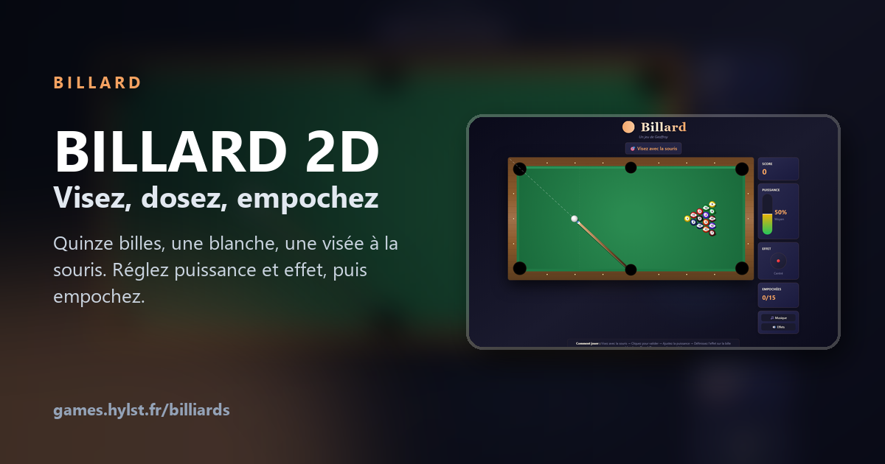

# Billard

**Visez, dosez, empochez.**

Billard 2D : quinze billes, une blanche, une visée à la souris. Réglez puissance et effet, puis empochez. Score, combos, son et musique.

Joue ici : [games.hylst.fr/billiards/](https://games.hylst.fr/billiards/)



## Comment on joue

- Billard complet : quinze billes, blanche, rack et six poches.
- Visée à la souris, puissance réglable, effet sur la blanche et simulation physique.
- Score, combos, billes empochées, particules et traînées.
- Musique et effets sonores synthétisés avec Web Audio.

## Technique

- React 19, TypeScript, Vite 7 et Tailwind CSS 4.
- Build en un seul fichier `index.html`, sans dépendance à l'exécution.
- Aucune requête réseau pendant la partie, aucun compte, aucun cookie.

```bash
npm ci
npm run build
```

Le build sort dans `dist/`. Le fichier `index.html` suffit pour jouer ; `og-image.png` et `icon.webp` accompagnent la publication.

## Structure

```
src/App.tsx        table, physique, visée, score
src/utils/sound.ts musique et effets
src/index.css      thème
```

## Licence

AGPL-3.0-or-later. Voir `LICENSE`.

Jeu créé par Geoffroy (Hylst) avec l'aide d'une IA.
